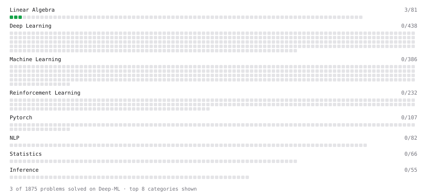

# Deep-ML

My machine learning practice from [Deep-ML](https://www.deep-ml.com). Every solution here was written by hand.

**15** solved · 15 problems · 0 labs · 0 math

[**Browse the interactive portfolio**](https://saverin0.github.io/deep-ml/) to replay this filling in over time.

## Problems

| | Difficulty | Solved | |
| --- | --- | --- | --- |
| [Calculate Accuracy Score](https://www.deep-ml.com/problems/36) | easy | 2026-10-16 | [solution](problems/0036-calculate-accuracy-score) |
| [Calculate Covariance Matrix](https://www.deep-ml.com/problems/10) | easy | 2026-10-31 | [solution](problems/0010-calculate-covariance-matrix) |
| [Calculate Dice Score for Classification](https://www.deep-ml.com/problems/73) | easy | 2026-10-20 | [solution](problems/0073-calculate-dice-score-for-classification) |
| [Calculate F1 Score from Predicted and True Labels](https://www.deep-ml.com/problems/91) | easy | 2026-10-19 | [solution](problems/0091-calculate-f1-score-from-predicted-and-true-labels) |
| [Calculate Jaccard Index for Binary Classification](https://www.deep-ml.com/problems/72) | easy | 2026-10-20 | [solution](problems/0072-calculate-jaccard-index-for-binary-classification) |
| [Compute TPR and FPR from Classifications](https://www.deep-ml.com/problems/1217) | easy | 2026-10-20 | [solution](problems/1217-compute-tpr-and-fpr-from-classifications) |
| [Feature Scaling Implementation](https://www.deep-ml.com/problems/16) | easy | 2026-10-28 | [solution](problems/0016-feature-scaling-implementation) |
| [Generate a Confusion Matrix for Binary Classification](https://www.deep-ml.com/problems/75) | easy | 2026-10-20 | [solution](problems/0075-generate-a-confusion-matrix-for-binary-classification) |
| [Implement Precision Metric](https://www.deep-ml.com/problems/46) | easy | 2026-10-16 | [solution](problems/0046-implement-precision-metric) |
| [Implement Recall Metric in Binary Classification](https://www.deep-ml.com/problems/52) | easy | 2026-10-16 | [solution](problems/0052-implement-recall-metric-in-binary-classification) |
| [Matrix-Vector Dot Product](https://www.deep-ml.com/problems/1) | easy | 2025-05-31 | [solution](problems/0001-matrix-vector-dot-product) |
| [Reshape Matrix](https://www.deep-ml.com/problems/3) | easy | 2025-08-26 | [solution](problems/0003-reshape-matrix) |
| [Transpose of a Matrix](https://www.deep-ml.com/problems/2) | easy | 2025-08-25 | [solution](problems/0002-transpose-of-a-matrix) |
| [Calculate AUC (Area Under ROC Curve)](https://www.deep-ml.com/problems/277) | medium | 2026-10-24 | [solution](problems/0277-calculate-auc-area-under-roc-curve) |
| [Implement ROC Curve Calculation](https://www.deep-ml.com/problems/276) | medium | 2026-10-23 | [solution](problems/0276-implement-roc-curve-calculation) |

---

_This file is regenerated by Deep-ML on every push._
